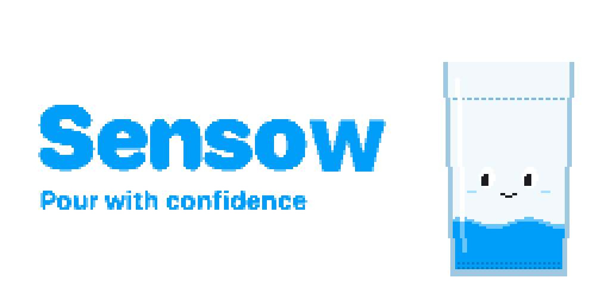
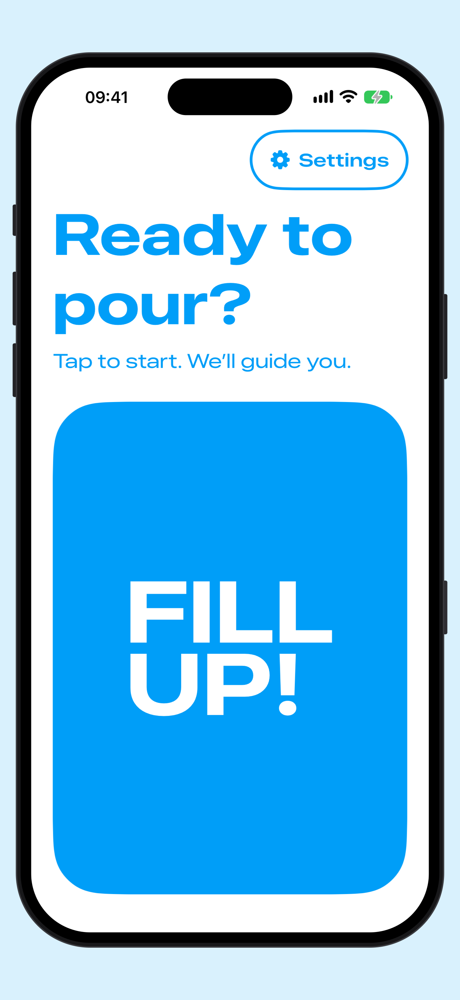
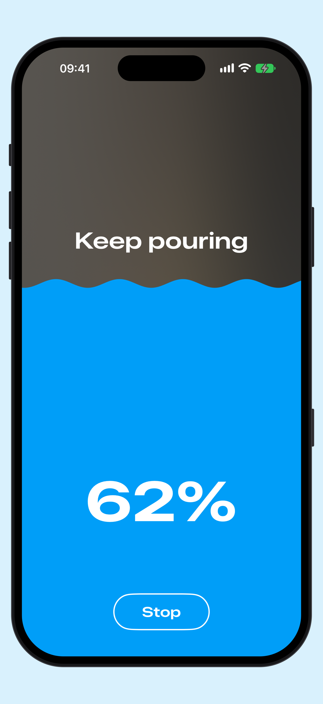
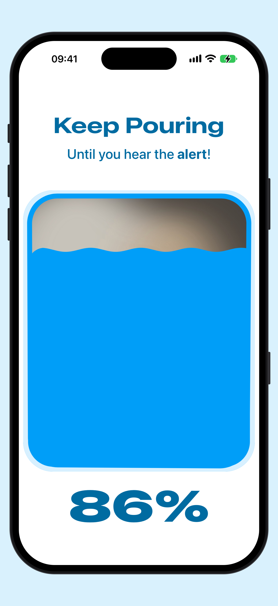
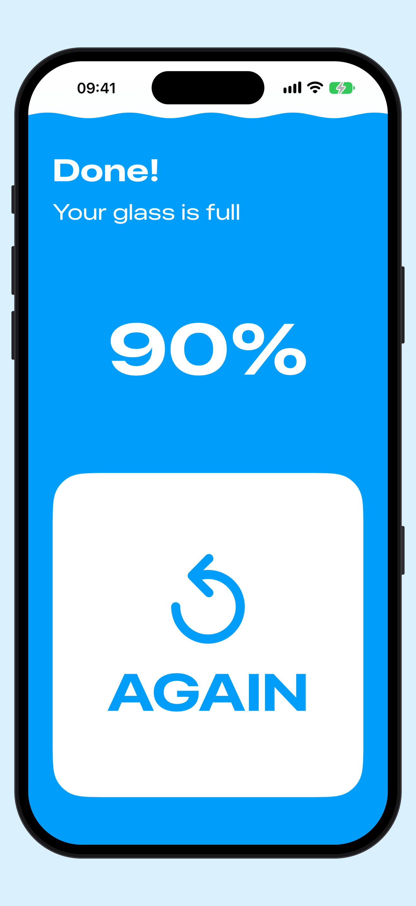
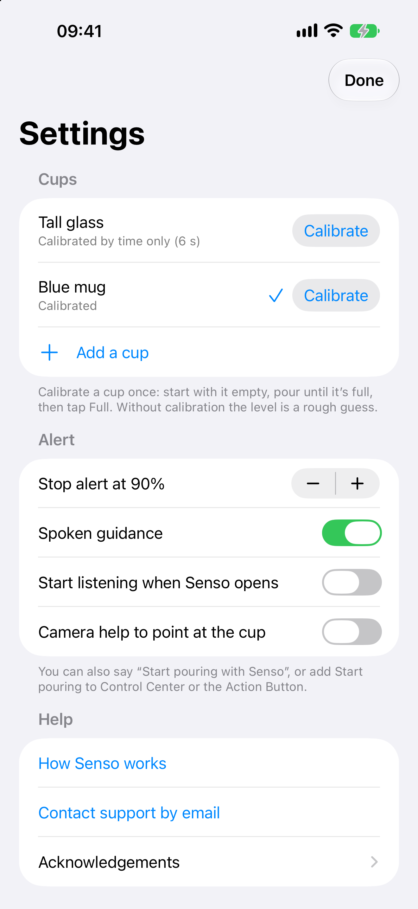
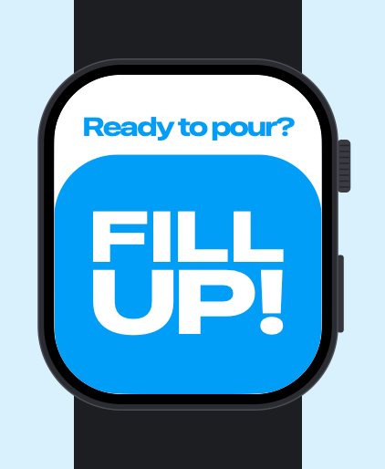
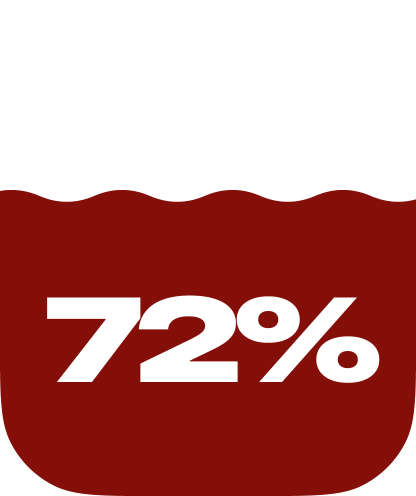
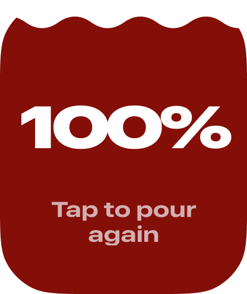
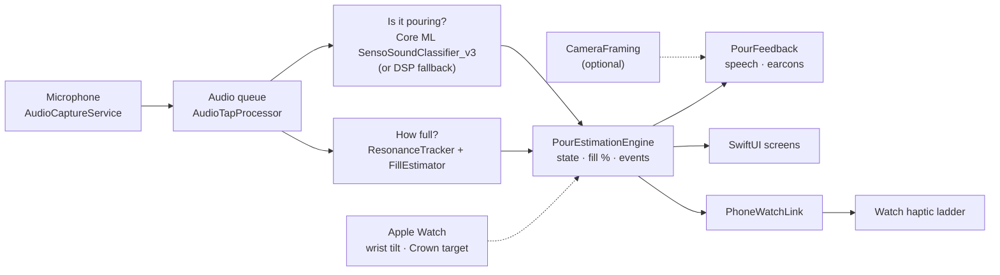

# Senso: Pouring Assistant

**Hear when your cup is full.** Senso is an iPhone and Apple Watch app that helps blind and low-vision people pour drinks without overflowing. Put the iPhone next to the cup and start pouring. Senso listens to the liquid, works out how full the cup is from the sound, and says "Stop! Glass is full" early enough for you to stop in time.

<p align="center">
  
  
  
  
  
</p>
<p align="center">
  
  
  
</p>

- **Platforms:** iOS 18+ and watchOS 11+, plus a Control Center control
- **Language:** Swift 6 with SwiftUI. No third-party dependencies.
- **Privacy:** everything runs on the device. No account, no network, no analytics, no data collected.
- **Status:** feature-complete, App Store kit ready. It hasn't run on real hardware yet (see [Status](#status-what-is-verified-and-what-isnt)).

---

## Contents

1. [What it does](#what-it-does)
2. [How it works](#how-it-works)
3. [The sound model](#the-sound-model)
4. [Design](#design)
5. [Accessibility](#accessibility)
6. [Privacy](#privacy)
7. [Technologies](#technologies)
8. [Project structure](#project-structure)
9. [Build and test](#build-and-test)
10. [Status: what is verified and what isn't](#status-what-is-verified-and-what-isnt)
11. [Publishing](#publishing)
12. [Credits](#credits)

---

## What it does

1. **Start.** Tap **Fill Up**, say *"Start pouring with Senso"*, press the Action Button, or use the Control Center control. Senso says "Listening. Start pouring when you're ready."
2. **Pour.** Senso hears the liquid start ("Pouring.") and speaks the level at 25, 50, 75 and 85 %.
3. **High alert.** From 70 % the screen switches to the alert state and a short earcon plays.
4. **Stop.** When the projected level reaches your target (90 % by default, 70–100 % in Settings), Senso plays the stop sound and says "Stop! Glass is full."

Also:

- **Apple Watch.** The Watch mirrors the pour and taps your wrist faster as the cup fills, so you can follow without looking or listening. Turn the Digital Crown to set the stop level.
- **Cups.** Save your favourite cups and calibrate each one with a single pour (empty to full, then tap **Full**). Later pours into that cup are more accurate.
- **Camera help (optional, off by default).** Before the pour, spoken tips help you point the iPhone at the cup: "Move the phone left", "Move closer", "Cup centred".
- **Onboarding.** A welcome sheet on first launch, in Apple's own style, explains where to put the iPhone, how a pour works, calibration, privacy and safety. Settings › Help › How Senso works shows it again.
- **Settings:** cups and calibration, stop level, spoken guidance on/off, start listening when Senso opens, camera help, help, acknowledgements, and support by email.

Senso is an aid, not a guarantee. The level can be wrong, especially with cups you haven't calibrated, in noisy rooms, or with thick liquids. The app says so.

---

## How it works

The iPhone does all the sensing. The microphone feeds two things at once: a **sound classifier** that answers "is liquid pouring right now?", and a **resonance tracker** that answers "how full is the cup?". The **pour engine** fuses them into one state and one number. Feedback, the screen and the Watch only react to what the engine decides.



### 1. Listening (`SensoApp/Audio/AudioCaptureService.swift`)

- Owns the `AVAudioSession` and an `AVAudioEngine` input tap.
- Prefers the built-in microphone even when AirPods are connected, because the phone sits next to the cup.
- Handles interruptions (a call or Siri takes the mic) and route changes.
- Audio buffers never touch the main thread. The tap hands each buffer to `AudioTapProcessor`, which runs every consumer on one private serial queue.

### 2. Is liquid pouring? (`SensoApp/ML/CoreMLInferencePipelines.swift`)

Two interchangeable classifiers sit behind one protocol, `AcousticClassifierProtocol`:

- **`SoundAnalysisClassifier`** runs the bundled Create ML model through SoundAnalysis. It loads the highest-numbered `SensoSoundClassifier_v*` in the app bundle (so `_v10` beats `_v2`). Classes: `pouring`, `not_pouring`, `background_noise`.
- **`DSPAcousticClassifier`** is a hand-tuned Accelerate (vDSP) heuristic, used only when no model is bundled. It scores ~85 ms frames on cues a pour has: broadband 1–8 kHz energy, spectral flatness, loudness above the room, and a rising pitch. The UI labels it **"DSP Mode (Uncalibrated)"**, so a heuristic is never mistaken for a trained model.

Every reading carries an `EstimateSource` (trained model with version, DSP fallback, or none), and the screen shows it as a badge.

### 3. How full is the cup? (`SensoApp/ML/FillEstimator.swift`)

This part is physics, not machine learning. While you pour, the air above the liquid rings like a pipe closed at one end:

```
f = c / (4 · (air length + 0.62 · radius))
```

As the cup fills, the air column gets shorter and the pitch rises. The *period* (1/f) falls in a straight line with liquid height, so the speed of sound cancels out:

```
fill = (1/f_empty − 1/f) / (1/f_empty − 1/f_full)
```

- **Finding the right pitch.** A pour also rings at fixed frequencies (the jug, the room, the stream), and splashes put random peaks everywhere, so the loudest peak in one frame is usually wrong. `ResonanceTracker` searches *trajectories* instead: for every candidate pitch and rise rate, it adds up spectral salience along the path physics predicts over the last 2 s, keeps the best one, and subtracts peaks that stay still.
- **Calibration.** One calibration pour per cup measures `f_empty` and `f_full` and stores them in a `ContainerProfile` (`CupStore`, UserDefaults). Without calibration, `f_full` is guessed from a typical cup radius, and the reading is flagged as rougher.
- **When the pitch can't be heard,** the estimate falls back to the time the calibration pour took.
- Each `FillReading` reports `fraction`, `uncertainty`, `ratePerSecond` and the method used (`pitchCalibrated`, `pitchUncalibrated`, `timeCalibrated`).
- The same file compiles on a Mac, so `MLTraining/EvaluateFillEstimator.swift` can replay recordings through it.

### 4. The pour engine (`SensoApp/Engine/PourEstimationEngine.swift`)

Pure logic on the main actor: no audio, no UI. States: `ready → preparing → pouring → approachingTarget → complete` (plus `uncertain` and `unavailable`).

- **Hysteresis.** Pouring starts at classifier confidence ≥ 0.7 and continues while it stays ≥ 0.4. The pour counts as paused after 1.5 s of "not pouring". If the Watch feels the wrist tilt as if pouring, 0.45 is enough to start.
- **Stop early enough to actually stop.** The alert fires when

  ```
  fill + rate × reaction time + uncertainty / 2 ≥ target
  ```

  Reaction time covers the alert starting, the person reacting and the tail of the stream: 0.9 s with speech, 0.75 s with the Watch (a tap starts sooner than speech).
- **No made-up numbers.** Fill estimates older than 1 s are dropped, and the screen shows "—" instead of a number.
- The engine emits `PourEvent`s (`listening`, `pouringDetected`, `pouringPaused`, `milestone(n)`, `approachingTarget`, `complete`, `lostMicrophone`, `unavailable`) that the feedback layer reacts to.
- If Senso leaves the screen mid-pour, iOS stops the mic. Senso ends the pour cleanly and says so when you come back.

### 5. Feedback (`SensoApp/Feedback/PourFeedback.swift`)

- **One voice at a time:** VoiceOver announcements when VoiceOver is on, otherwise Senso's own `AVSpeechSynthesizer`, never both.
- **Earcons** generated in code mark the high-alert band and the stop.
- **The iPhone vibrates only when it isn't listening** (start, stop, glass full, errors). Vibration travels through the table into the cup and the microphone, so while pouring the Watch's taps carry the level.

### 6. Apple Watch (`SensoWatch Watch App/`, `SensoApp/Watch/PhoneWatchLink.swift`)

- **WatchConnectivity** carries shared `Codable` payloads as JSON (`WatchSync` in `SharedModels`). iPhone → Watch: state, fill %, target. Watch → iPhone: commands (start, stop, pour again), the Digital Crown target, and wrist tilt.
- **Haptic ladder:** one click when the cup is locked; "up" every 1.2 s at 50–69 %, every 0.6 s at 70–89 %, "retry" every 0.3 s from 90 %; then "stop" and "notification" when full.
- **Wrist tilt** (Core Motion `TiltDetector`) lowers the engine's start threshold.
- **Extended runtime session** (`WKExtendedRuntimeSession`, self-care type) keeps the taps going while the wrist is turned to hold the cup. It ends when the pour does.

### 7. Hands-free start (`SharedIntents/`, `SensoControls/`, `SensoApp/Intents/`)

`StartPouringIntent` is one App Intent behind Siri ("Start pouring with Senso"), Shortcuts, the Action Button and the Control Center / Lock Screen control (`SensoControls` widget extension). It opens the app, and the root view starts a pour, even on a cold launch. There's also an option to start listening as soon as Senso opens.

### 8. Camera help (`SensoApp/Camera/CameraFraming.swift`)

Opt-in. Vision's built-in image classifier (`VNClassifyImageRequest`) checks for a cup-like object, and objectness saliency finds where it is. The result becomes a spoken framing cue before the pour. When neither is sure, the cue is "no cup", never a guess. The camera never estimates fill. While it runs, it also samples the picture's colours into a 3×3 grid for the pouring screen's background, capped so white text keeps at least 7:1 contrast.

---

## The sound model

The bundled model, **`SensoSoundClassifier_v3`**, is a Create ML `MLSoundClassifier` (Apple's `audioFeaturePrint` features, ~1 s windows, overlap 0.75, so a new result about every 0.24 s).

### Training data: commercial-use only

Senso is meant for the App Store, so the shipped model uses only data that allows commercial use: **3,207 FSD50K clips licensed CC0 or CC BY**.

- **Pouring:** every CC0/CC BY "Pour" and "Fill (with liquid)" clip (359).
- **Not pouring:** dishes, cutlery, microwave, frying, boiling, speech, music, cupboards, doors, typing, footsteps, clinking glass and more. Taps, sinks and trickling water are left out, because they can sound like a real pour.
- **Background noise:** fans, traffic, crowds, hiss, wind, rain, trains.
- **Test split:** eval clips from half the eval recordists, chosen by a stable hash of the uploader name, so the test numbers come from people and microphones the model never heard.
- **Augmentation:** FSD50K has ~6× more negatives than pours, and Create ML has no class weights. So each training pour is also written mixed with room noise and with speech, 5–20 dB below the pour.
- **Licence guard:** the prep script is commercial-only by default. `--include-noncommercial` adds The Sound of Water and ESC-50 for research comparisons. `train-sound` writes the data licence into the model's metadata and marks the model **NOT FOR RELEASE** if any non-commercial clip was used.
- **Attribution:** every CC BY creator is credited in the app (Settings › Help › Acknowledgements, from `SensoApp/ML/TrainingDataCredits.txt`). Full details: [`MLTraining/External/ATTRIBUTION.md`](MLTraining/External/ATTRIBUTION.md).

### Results (531 held-out FSD50K clips, replayed through the engine's start/keep/pause rule)

| Model | Training data | Pouring precision / recall | Pours detected | Pour time detected | False starts per minute |
| --- | --- | --- | --- | --- | --- |
| v1 | Sound of Water, ESC-50, FSD50K (not publishable) | 68.6 % / 68.2 % | 99 % | 82 % | 1.9 |
| v2 | FSD50K, no augmentation | 80.4 % / 58.9 % | 91 % | 70 % | 0.7 |
| **v3 (shipped)** | FSD50K + mixed pours | 65.1 % / 71.9 % | 96 % | 83 % | 1.4 |

Pour-time coverage matters most: if detection drops mid-pour, the level estimate freezes and Stop comes late, while a false start only causes an early "Pouring." message. The 0.7 start threshold was picked on this test set, so these numbers are slightly optimistic.

### Retraining

Everything is in [`MLTraining/`](MLTraining/README.md) (Mac only, because Create ML is macOS-only):

```bash
cd MLTraining
xcrun swift PrepareExternalData.swift                 # builds Dataset/ and TestDataset/ from External/fsd50k
xcrun swift TrainSensoModels.swift train-sound --version 4 --iterations 100
xcrun swift TrainSensoModels.swift evaluate-sound Models/SensoSoundClassifier_v4.mlmodel
```

The FSD50K audio (~6 GB) isn't in this repo. `MLTraining/External/fsd50k/manifest.csv` lists every clip used, with its licence, uploader and title; download those clips from the FSD50K mirror (Hugging Face `Fhrozen/FSD50k`) into `External/fsd50k/dev` and `External/fsd50k/eval`. Pass `--version` because a fresh clone has no older models in `Models/` to count from.

The app's **Data Collection** screen (Debug builds only, the waveform button on the Ready screen) records labelled clips in exactly the layout the trainer reads: 16-bit WAV plus a JSON sidecar (container, material, liquid, speed, ground truth), exported as a zip.

`TrainSensoModels.swift` also has templates for a container detector (`train-objects`) and a Watch tilt classifier (`train-activity`), waiting for data.

---

## Design

The visual spec is the **"Almost Purple"** design. Tokens and the liquid shape live in [`SharedModels/SensoDesign.swift`](SharedModels/SensoDesign.swift) and are shared by iPhone and Watch.

| Token | Value | Used for |
| --- | --- | --- |
| Crimson | `#840E08` | Brand red: buttons, liquid, titles |
| Sky | `#C9E7F6` | "FILL UP!" text, the Home button |
| Sky Mist | `#D9F1FD` | Empty part of the glass on the Done screen |
| Blush | `#EED3D4` | Watch "Tap to pour again" (the design's pink, lightened to pass 7:1) |

- **Type:** SF Pro Expanded, which is the system font at `.width(.expanded)`. No font files are bundled, so Dynamic Type keeps working. (watchOS ignores the expanded width.)
- **Screens:** Ready → Pouring (normal / high alert) → Done, on iPhone and Watch.
- **The liquid:** `LiquidShape` is a sine-wave surface. `MovingLiquid` animates it with a `TimelineView`: it drifts one wavelength every 3 s and swells ±15 % over 5 s, so the liquid keeps moving while the level holds. Percentages change with `.contentTransition(.numericText)`.
- **Transitions:** the root view is a `ZStack` (Ready < Pouring < Done). Pouring slides in from the bottom and fades out; Done slides in and out from the bottom.
- **Home:** a large labelled **Settings** button (at least 64 pt) in the corner, read last by VoiceOver.
- **Onboarding** uses Apple's native welcome-sheet style: system fonts, symbol + title + subtitle rows, a prominent Continue button.
- **App icon:** a crimson wave on sky blue (iPhone and Watch).

Deliberate departures from the design, all for accessibility or honesty: a sensor/source badge, a Stop button, a darker stand-in for the blurred camera background (to keep 7:1 contrast), and the lighter Watch pink.

---

## Accessibility

Accessibility is the product, not an add-on.

- **VoiceOver first.** Every control has a label, states are spoken, and progress goes through VoiceOver announcements when it's on.
- **Contrast ≥ 7:1 (WCAG AAA)** everywhere: white on crimson 10.3:1, sky on crimson 7.9:1, blush on crimson 7.3:1. The camera-tinted background is capped to keep it (`SceneColorTests`).
- **Dynamic Type** on every text style, including the expanded brand font.
- **Reduce Motion:** the liquid stays still and screens only fade.
- **Never colour alone:** every state is also spelled out in words.
- **Honest numbers:** no estimate shows "—", and the source badge says whether a trained model or the DSP fallback is listening.
- **Multimodal:** speech, earcons and Watch haptics, each usable on its own.

---

## Privacy

- Sound and camera frames are analysed on the device in real time. Nothing is recorded during a pour, and nothing leaves the iPhone.
- No account, no ads, no analytics, no network features.
- [`SensoApp/PrivacyInfo.xcprivacy`](SensoApp/PrivacyInfo.xcprivacy): no tracking, no collected data. Required-reason APIs: UserDefaults (CA92.1), system uptime (35F9.1), file timestamps (C617.1).
- The App Store privacy label is "Data Not Collected". Policy text: [`AppStore/privacy-policy.md`](AppStore/privacy-policy.md).

---

## Technologies

| Area | Frameworks and techniques |
| --- | --- |
| Language | Swift 6, strict concurrency, main-actor default isolation with Approachable Concurrency; audio and shared types are `nonisolated` |
| UI | SwiftUI, Observation (`@Observable`), `TimelineView`, custom `Shape`s |
| Audio | AVFoundation (`AVAudioSession`, `AVAudioEngine`), Accelerate / vDSP (FFT, spectral features) |
| Machine learning | Core ML, SoundAnalysis, Create ML (`MLSoundClassifier`) for training |
| Signal processing | Air-column resonance physics, trajectory search pitch tracking, per-cup calibration |
| Vision | Vision (`VNClassifyImageRequest`, objectness saliency), AVCaptureSession frame sampling |
| Speech and sound | `AVSpeechSynthesizer`, VoiceOver announcements, generated earcons |
| Watch | WatchConnectivity, WatchKit haptics, Core Motion, `WKExtendedRuntimeSession`, Digital Crown |
| System integration | App Intents, App Shortcuts (Siri), WidgetKit `ControlWidget` (Control Center, Lock Screen, Action Button) |
| Storage | UserDefaults (cups, settings), WAV + JSON files for Data Collection, `NSFileCoordinator` zip export |
| Testing | Swift Testing, synthetic audio signals, a tiny test-only Core ML model |
| Tooling | Xcode 27, hand-written `project.pbxproj` with synchronized folders (objectVersion 77) |

---

## Project structure

```
Senso/
├── SensoApp/                    iPhone app
│   ├── Audio/                   Microphone, session, interruptions
│   ├── ML/                      Sound classifier (Core ML + DSP fallback), fill estimator, bundled v3 model, credits
│   ├── Engine/                  PourEstimationEngine: state machine and stop timing
│   ├── Feedback/                Speech, VoiceOver announcements, earcons
│   ├── Camera/                  Optional framing cues and scene colours
│   ├── Watch/                   iPhone side of WatchConnectivity
│   ├── Views/                   Ready / Pouring / Done, Settings (CupsView), Acknowledgements
│   ├── Onboarding/              First-launch welcome sheet module
│   ├── Intents/                 App Shortcuts (Siri phrases)
│   ├── DataCollection/          Debug-only recorder for training clips
│   ├── Debug/                   Debug-only screenshot scenes (-SensoScreenshot <scene>)
│   └── PrivacyInfo.xcprivacy
├── SensoWatch Watch App/        Watch UI, WatchLink, haptic ladder, tilt, runtime session
├── SensoControls/               Control Center / Lock Screen / Action Button control
├── SharedModels/                Types and design tokens shared by iPhone and Watch
├── SharedIntents/               StartPouringIntent (app + control extension)
├── SensoTests/                  Unit tests and a synthetic test model
├── MLTraining/                  Data prep, training, evaluation scripts (Mac), dataset manifest and attribution
└── AppStore/                    Listing, review notes, privacy policy, screenshots, release checklist
```

---

## Build and test

Requirements: Xcode 27.2 (iOS / watchOS 27.2 SDKs) on macOS. Open `Senso.xcodeproj`, pick the **Senso** scheme, and run. Signing uses your own team; bundle IDs are `com.alessandrosignorile.Senso`, `.watchkitapp`, and the control extension.

From the command line (if `xcode-select` points at the Command Line Tools, prefix each command with `DEVELOPER_DIR=/Applications/Xcode.app/Contents/Developer`):

```bash
xcodebuild build -project Senso.xcodeproj -scheme Senso -destination 'generic/platform=iOS Simulator' CODE_SIGNING_ALLOWED=NO
```

```bash
xcodebuild test -project Senso.xcodeproj -scheme Senso -destination 'platform=iOS Simulator,name=iPhone 18 Pro'
```

The test suite (34 Swift Testing tests) covers audio levels and buffer copies, the WAV writer and the Data Collection recorder (save, relabel, delete, zip export), Watch message encoding, the DSP classifier on synthetic noise vs. tone, model version picking and the bundled v3 model, the resonance tracker and calibration on synthetic pours, the pour engine (hysteresis, milestones, stop timing, stale estimates, interruptions, calibration pours), camera framing cues, and the scene-colour contrast cap.

Debug-only tools:

- **Data Collection:** waveform button on the Ready screen.
- **Screenshot mode:** launch with `-SensoScreenshot <scene>`. iPhone: `ready`, `pouring`, `alert`, `done`, `onboarding`, `settings`. Watch: `ready`, `pouring`, `done`.

---

## Status: what is verified and what isn't

**Verified**

- Builds for iOS and watchOS; the Release device build compiles unsigned.
- All unit tests pass in the simulator.
- The Watch app launches in the watchOS 27.2 simulator.
- The sound model's numbers on held-out FSD50K recordings (table above).

**Not verified yet (needs real hardware)**

- Pouring into a real glass on a real iPhone microphone in a kitchen.
- Fill accuracy. The resonance tracker follows the physics on tall cylinders from roughly 15–65 % fill; near the brim the resonance often fades and the estimate extrapolates. The public data can't measure accuracy, because those pours don't reliably end at "full". This needs recordings with a measured final level.
- Watch haptics, the extended runtime session, and the Control Center control on devices.
- Camera framing and scene colours (the simulator has no camera).

**Next steps:** device runs, a few real-kitchen test clips through `evaluate-sound`, and measured-level pours for fill accuracy.

---

## Publishing

[`AppStore/`](AppStore/README.md) has everything for App Store Connect: the release checklist, the listing text ([`metadata.md`](AppStore/metadata.md)), notes for App Review ([`review-notes.md`](AppStore/review-notes.md)), the privacy policy that doubles as the support page, and ready-to-upload screenshots (iPhone 6.9″ at 1320 × 2868, Apple Watch at 422 × 514). Version 1.0 (1), `ITSAppUsesNonExemptEncryption = NO`.

Known review risk: the Watch's self-care extended runtime session. The fallback is documented in the checklist.

---

## Credits

- Sound data: **FSD50K** (Fonseca, Favory, Pons, Font, Serra, IEEE/ACM TASLP 2022), CC0 and CC BY clips only. Every CC BY creator is listed in `SensoApp/ML/TrainingDataCredits.txt` and in the app.
- Resonance model: Bagad, Tapaswi, Snoek, Zisserman, *"The Sound of Water: Inferring Physical Properties from Pouring Liquids"*, ICASSP 2025.

© 2026 Alessandro Signorile. All rights reserved. This is a private repository.
